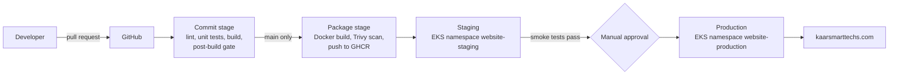

# kaarsmarttechs.com: website and continuous delivery pipeline

Company website for **Kaar Smart Techs** (Delmenhorst, Germany), delivered through a continuous
delivery pipeline: every commit to `main` is built once, tested, packaged into an immutable
container image, scanned, deployed to staging automatically and promoted to production after a
manual approval.

## Architecture



| Layer          | Technology                                                                      |
| -------------- | ------------------------------------------------------------------------------- |
| Frontend       | Astro 5 (static output), TypeScript, self-hosted fonts                          |
| Content        | Markdown project entries validated by a typed schema (`src/content.config.ts`)  |
| Runtime        | nginx (unprivileged, read-only filesystem) in a container                       |
| Orchestration  | Kubernetes on Amazon EKS, Kustomize overlays per environment                    |
| Infrastructure | Terraform: VPC, EKS, GitHub OIDC deploy role, region `eu-central-1` (Frankfurt) |
| CI/CD          | GitHub Actions: `delivery.yml`, reusable `deploy.yml`, `infrastructure.yml`     |

## Pipeline stages and quality gates

| Stage      | Trigger                     | Gate (the stage fails if...)                                                                                                                |
| ---------- | --------------------------- | ------------------------------------------------------------------------------------------------------------------------------------------- |
| Commit     | every PR and push           | formatting differs (Prettier), type errors (`astro check`), unit tests fail, build fails                                                    |
| Post-build | every PR and push           | broken internal link, missing title/description/h1, missing Impressum or privacy link, inline script (CSP), any third-party resource (GDPR) |
| Package    | push to `main`              | fixable HIGH or CRITICAL vulnerability in the image (Trivy)                                                                                 |
| Staging    | after package               | rollout not healthy within 180 s, or smoke test fails (then automatic rollback)                                                             |
| Production | approval in GitHub          | same as staging, against the production URL                                                                                                 |
| Infra      | changes to `infra/`, `k8s/` | `terraform fmt`/`validate` fails, rendered manifests violate the Kubernetes schema                                                          |

Key delivery properties:

- **Build once, promote unchanged.** Environments receive the same image, referenced by its
  `sha256` digest, never by a mutable tag.
- **Traceability.** Each image serves `/version.txt` with its commit SHA; the smoke test checks it,
  so a deployment that did not actually change the live site fails.
- **Keyless deployment.** GitHub Actions assumes an AWS role through OIDC; the role trust policy only
  accepts jobs bound to the `staging` or `production` environments of this repository, and its
  cluster access is limited to the two website namespaces.
- **Zero-downtime rollouts.** `maxUnavailable: 0`, readiness probes and a PodDisruptionBudget.
- **Automatic rollback** with `kubectl rollout undo` when the rollout or smoke test fails.

## Run locally

```bash
npm ci
npm run dev                # http://localhost:4321
npm run lint && npm test   # commit-stage checks
npm run build && npm run test:dist
docker compose up --build  # production container on http://localhost:8080
./scripts/smoke-test.sh http://localhost:8080 local
```

Add a portfolio project by creating `src/content/projects/<slug>.md`; the schema rejects missing
or invalid fields at build time. Leave a metric's `value` empty until it is measured: the page
shows "Measuring" instead of an estimate.

## Release artifact: WordPress + nginx + FastAPI + MariaDB

`wordpress/` contains the same site on WordPress 7.1 (PHP 8.5), with a FastAPI service (Python
3.14) for project data and the contact form, behind nginx and backed by MariaDB 11.8. WordPress
renders the pages and lets editors change the Impressum and privacy policy without a release;
FastAPI syncs the project entries from `src/content/projects` into MariaDB, serves them to the
theme and stores contact form messages (deleted after 180 days). No page sets a cookie for visitors.

It ships as three images built from `wordpress/Dockerfile`, with the repository root as build
context:

- `ghcr.io/alainahuili/website-wordpress-app`: WordPress on PHP-FPM, with WP-CLI for the setup job
- `ghcr.io/alainahuili/website-wordpress-api`: FastAPI on uvicorn
- `ghcr.io/alainahuili/website-wordpress-web`: nginx serving static files and routing to both

The `wordpress.yml` workflow runs Ruff and pytest against MariaDB and lints the PHP, builds and
scans the three images, starts them with MariaDB through `wordpress/docker-compose.yml`, runs
`scripts/smoke-test.sh`, the post-build quality gate against the live pages and a contact form
round trip, and on `main` pushes exactly the images it tested. It then deploys them by digest
through `deploy-wordpress.yml` (Kustomize overlays in `k8s/wordpress/`) to
`wp.staging.kaarsmarttechs.com` and, after approval, to production at **kaarsmarttechs.com**. The
first deployment to each namespace generates the database and WordPress secrets inside the cluster.
The Astro site (`delivery.yml`) now deploys to staging only.

```bash
export WORDPRESS_SECRET="$(openssl rand -base64 32)" API_SECRET="$(openssl rand -base64 32)"
export WORDPRESS_ADMIN_PASSWORD="$(openssl rand -base64 18)"
docker compose -f wordpress/docker-compose.yml up --build   # http://localhost:8082
```

See [wordpress/README.md](wordpress/README.md) for the architecture and configuration.

## First-time setup

1. Create the Terraform state bucket `kaarsmarttechs-terraform-state` in `eu-central-1`.
2. Make sure the account has the GitHub OIDC identity provider (`token.actions.githubusercontent.com`,
   audience `sts.amazonaws.com`); Terraform looks it up instead of owning it, since it is shared.
3. `cd infra/terraform && terraform init && terraform apply` (creates VPC, EKS and the deploy role;
   EKS with a NAT gateway and two t3.medium nodes costs roughly in the low hundreds of euros per month).
4. Install ingress-nginx with `infra/helm/ingress-nginx.yaml` (see the command in that file) and
   cert-manager (Helm, `crds.enabled=true`), then apply the cluster-scoped resources the deploy
   role may not create: `kubectl apply -f infra/kubernetes/` (namespaces, `letsencrypt` ClusterIssuer,
   gp3 StorageClass).
5. In GitHub, create environments `staging` and `production`; add required reviewers to
   `production`; add the secret `AWS_DEPLOY_ROLE_ARN` (Terraform output `deployer_role_arn`).
6. Point DNS for `kaarsmarttechs.com`, `staging.kaarsmarttechs.com` and `wp.staging.kaarsmarttechs.com`
   to the ingress load balancer.
7. Protect `main`: require the `Lint, test, build` check and a pull request review.

## Before going live

- Fill in every bracketed value in `src/pages/impressum.astro` and `src/pages/datenschutz.astro`
  and have both reviewed; an Impressum is mandatory for German business websites.
- Replace `hello@kaarsmarttechs.com` if a different address is used.
- Add measured results to the LEGO sorter entry, plus video and photos.

See [docs/decisions.md](docs/decisions.md) for the design decisions behind this setup.
