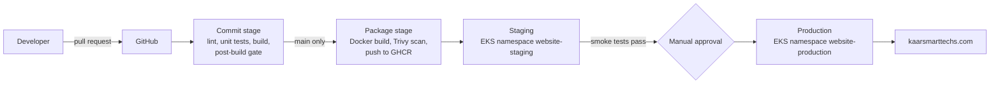

# kaarsmarttechs.com: website and continuous delivery pipeline

Company website for **Kaar Smart Techs** (Delmenhorst, Germany), delivered through a continuous
delivery pipeline: every commit to `main` is built once, tested, packaged into an immutable
container image, scanned, deployed to staging automatically and promoted to production after a
manual approval.

## Architecture



| Layer          | Technology                                                                      |
| -------------- | ------------------------------------------------------------------------------- |
| Frontend       | Astro 5 (static output), TypeScript, self-hosted fonts                          |
| Content        | Markdown project entries validated by a typed schema (`src/content.config.ts`)  |
| Runtime        | nginx (unprivileged, read-only filesystem) in a container                       |
| Orchestration  | Kubernetes on Amazon EKS, Kustomize overlays per environment                    |
| Infrastructure | Terraform: VPC, EKS, GitHub OIDC deploy role, region `eu-central-1` (Frankfurt) |
| CI/CD          | GitHub Actions: `delivery.yml`, reusable `deploy.yml`, `infrastructure.yml`     |

## Pipeline stages and quality gates

| Stage      | Trigger                     | Gate (the stage fails if...)                                                                                                                |
| ---------- | --------------------------- | ------------------------------------------------------------------------------------------------------------------------------------------- |
| Commit     | every PR and push           | formatting differs (Prettier), type errors (`astro check`), unit tests fail, build fails                                                    |
| Post-build | every PR and push           | broken internal link, missing title/description/h1, missing Impressum or privacy link, inline script (CSP), any third-party resource (GDPR) |
| Package    | push to `main`              | fixable HIGH or CRITICAL vulnerability in the image (Trivy)                                                                                 |
| Staging    | after package               | rollout not healthy within 180 s, or smoke test fails (then automatic rollback)                                                             |
| Production | approval in GitHub          | same as staging, against the production URL                                                                                                 |
| Infra      | changes to `infra/`, `k8s/` | `terraform fmt`/`validate` fails, rendered manifests violate the Kubernetes schema                                                          |

Key delivery properties:

- **Build once, promote unchanged.** Environments receive the same image, referenced by its
  `sha256` digest, never by a mutable tag.
- **Traceability.** Each image serves `/version.txt` with its commit SHA; the smoke test checks it,
  so a deployment that did not actually change the live site fails.
- **Keyless deployment.** GitHub Actions assumes an AWS role through OIDC; the role trust policy only
  accepts jobs bound to the `staging` or `production` environments of this repository, and its
  cluster access is limited to the two website namespaces.
- **Zero-downtime rollouts.** `maxUnavailable: 0`, readiness probes and a PodDisruptionBudget.
- **Automatic rollback** with `kubectl rollout undo` when the rollout or smoke test fails.

## Run locally

```bash
npm ci
npm run dev                # http://localhost:4321
npm run lint && npm test   # commit-stage checks
npm run build && npm run test:dist
docker compose up --build  # production container on http://localhost:8080
./scripts/smoke-test.sh http://localhost:8080 local
```

Add a portfolio project by creating `src/content/projects/<slug>.md`; the schema rejects missing
or invalid fields at build time. Leave a metric's `value` empty until it is measured: the page
shows "Measuring" instead of an estimate.

## First-time setup

1. Create the Terraform state bucket `kaarsmarttechs-terraform-state` in `eu-central-1`.
2. `cd infra/terraform && terraform init && terraform apply` (creates VPC, EKS and the deploy role;
   EKS with a NAT gateway and two t3.medium nodes costs roughly in the low hundreds of euros per month).
3. Install cluster add-ons: ingress-nginx and cert-manager with a `letsencrypt` ClusterIssuer.
4. In GitHub, create environments `staging` and `production`; add required reviewers to
   `production`; add the secret `AWS_DEPLOY_ROLE_ARN` (Terraform output `deployer_role_arn`).
5. Point DNS for `kaarsmarttechs.com` and `staging.kaarsmarttechs.com` to the ingress load balancer.
6. Protect `main`: require the `Lint, test, build` check and a pull request review.

## Before going live

- Fill in every bracketed value in `src/pages/impressum.astro` and `src/pages/datenschutz.astro`
  and have both reviewed; an Impressum is mandatory for German business websites.
- Replace `hello@kaarsmarttechs.com` if a different address is used.
- Add measured results to the LEGO sorter entry, plus video and photos.

See [docs/decisions.md](docs/decisions.md) for the design decisions behind this setup.
