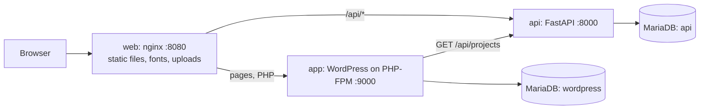

# kaarsmarttechs.com on WordPress + FastAPI

A release artifact of the website: WordPress 7.1 on PHP 8.5 renders the pages, a FastAPI service
on Python 3.14 serves the project data and receives the contact form, nginx sits in front of both,
and MariaDB 11.8 stores everything. The overview, images and pipeline are described in the
[root README](../README.md).



## Who does what

| Part      | Responsibility                                                                                                                                                                                                                                       |
| --------- | ---------------------------------------------------------------------------------------------------------------------------------------------------------------------------------------------------------------------------------------------------- |
| WordPress | Renders every page with the `kaarsmarttechs` theme (`theme/`). Owns the Impressum and privacy policy as pages editors change in `/wp-admin/` without a release. Editors can also add pages.                                                           |
| FastAPI   | `python -m app.sync` loads `src/content/projects` into MariaDB with the Astro schema's rules. `GET /api/projects` serves them to the theme (cached for a minute, last good answer kept). `POST /api/contact` stores messages and prunes them after 180 days. |
| nginx     | Serves static files and self-hosted fonts, routes `/api/` to FastAPI and PHP to WordPress, applies the shared security headers (a looser CSP only for the admin) and rate-limits logins.                                                             |
| MariaDB   | One server, two databases with separate users: `wordpress` and `api`. Neither service can read the other's tables.                                                                                                                                  |

Compared with the Astro site:

- The contact form posts to `/api/contact` as a plain HTML form and gets a redirect back to
  `/contact/?sent=1` (or `?error=...`), so it needs no script, session or cookie. It is rate limited
  (3 per minute and 20 per day per visitor, counted by a keyed hash of the IP address that is kept
  for one day and stored apart from the messages), has a honeypot field and rejects posts from
  other origins.
- No page sets a cookie for visitors; only editors who log in get WordPress's login cookies.
- Everything WordPress would expose beyond the pages is closed: posts, archives, search, feeds,
  author pages, sitemaps, XML-RPC, `wp-cron.php` and the REST API for anonymous users (it would
  list user names) all return 401 or 404. WordPress makes no outgoing requests except to the API.

## Develop

The stack runs only in containers. From the repository root:

```bash
export WORDPRESS_SECRET="$(openssl rand -base64 32)" API_SECRET="$(openssl rand -base64 32)"
export WORDPRESS_ADMIN_PASSWORD="$(openssl rand -base64 18)"
docker compose -f wordpress/docker-compose.yml up --build   # http://localhost:8082, admin at /wp-admin/
./scripts/smoke-test.sh http://localhost:8082 local
python3 wordpress/tests/site_check.py http://localhost:8082
```

The API alone, with Python 3.14:

```bash
cd wordpress/api
python -m venv .venv && . .venv/bin/activate
pip install -r requirements-dev.txt
pytest                    # SQLite in memory; set TEST_DATABASE_URL=mysql+pymysql://... for MariaDB
ruff check .. && ruff format --check ..
```

Theme changes need a new image: code is baked in and the admin cannot install or edit plugins,
themes or files. Rewrite rules live in `theme/kaarsmarttechs/inc/routes.php`.

## Configuration in production

| Variable                          | Service      | Purpose                                                                                             |
| --------------------------------- | ------------ | --------------------------------------------------------------------------------------------------- |
| `WORDPRESS_URL`                   | app          | Public URL, e.g. `https://kaarsmarttechs.com`; used for canonical links and `FORCE_SSL_ADMIN`.        |
| `WORDPRESS_SECRET`                | app          | Derives WordPress's keys and salts. Keep it secret and stable; changing it logs everyone out.       |
| `WORDPRESS_DB_*`                  | app, mariadb | WordPress database connection (`HOST`, `NAME`, `USER`, `PASSWORD`).                                 |
| `WORDPRESS_ADMIN_*`               | wp-setup     | First administrator (`USER`, `PASSWORD`, `EMAIL`). The password is only read on the first install. |
| `DB_*`                            | api          | API database connection (`HOST`, `PORT`, `DATABASE`, `USERNAME`, `PASSWORD`).                       |
| `API_SECRET`                      | api          | Keys the hash of visitor IP addresses for rate limiting. Required.                                  |
| `TRUSTED_PROXY_HOPS`              | api          | Proxies appending to `X-Forwarded-For`: `1` for nginx alone, `2` behind an ingress.                 |
| `CONTACT_RETENTION_DAYS`          | app, api     | Days before contact messages are deleted. Set the same value on both; the pages state it.          |
| `SITE_CONTACT_EMAIL`              | app          | Address shown on the contact page and in the seeded legal pages.                                     |

Before the new app containers of a release take traffic, run the two one-shot jobs (the
`api-setup` and `wp-setup` services in `docker-compose.yml`): `python -m app.sync` in the api
image, `kaar-setup` in the app image. Run `wp cron event run --due-now` every minute in one app
container (the `cron` service).

The web image expects PHP-FPM at `app:9000` and the API at `api:8000` (see `docker/nginx.conf`).
Uploaded media live in `wp-content/uploads`, a volume shared by the app and web containers: on
Kubernetes this needs a `ReadWriteMany` volume (EFS) or an object storage plugin.

## Before going live

- Fill in the bracketed values in the Impressum and privacy policy, in `/wp-admin/` (the seed
  content in `theme/kaarsmarttechs/content/` is only used when the pages do not exist yet), and have
  both reviewed.
- WordPress sends no email (no mail server in the image): password resets need an SMTP plugin
  baked into the image, or an administrator using `wp user update` in the app container.
- Back up both databases once they hold real messages and edited pages.
